# เอกสารแผนภาพฐานข้อมูล FOMS

ตรงกับโมเดลในโค้ดบน branch `demo/full-system` (ต้นฉบับ Mermaid อยู่ในไฟล์ `.mmd` แก้เองได้ที่ https://mermaid.live)

## ภาพรวมทั้งหมด (23 กล่อง)
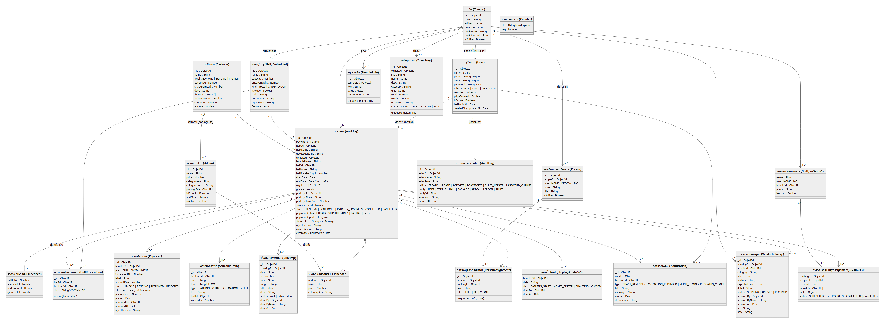

## แยกเป็น 3 ภาพย่อย (อ่านง่าย เหมาะใส่รายงาน)

### 1) โครงสร้างวัด ผู้ใช้ และการจอง
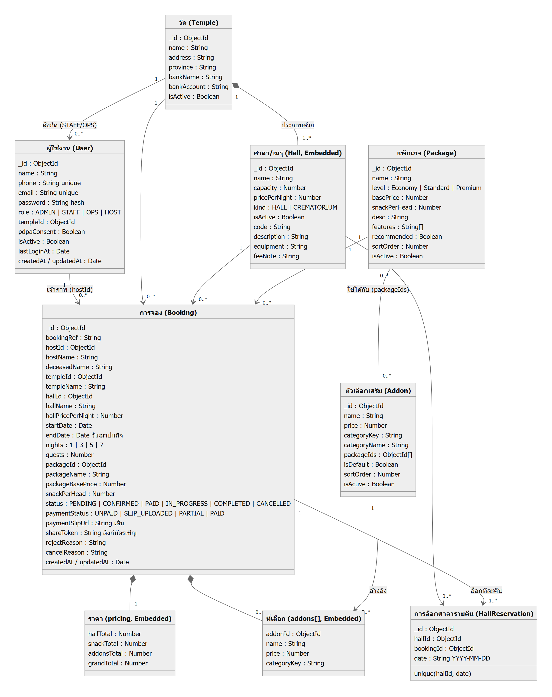

### 2) ชำระเงิน กำหนดการ และบุคลากร
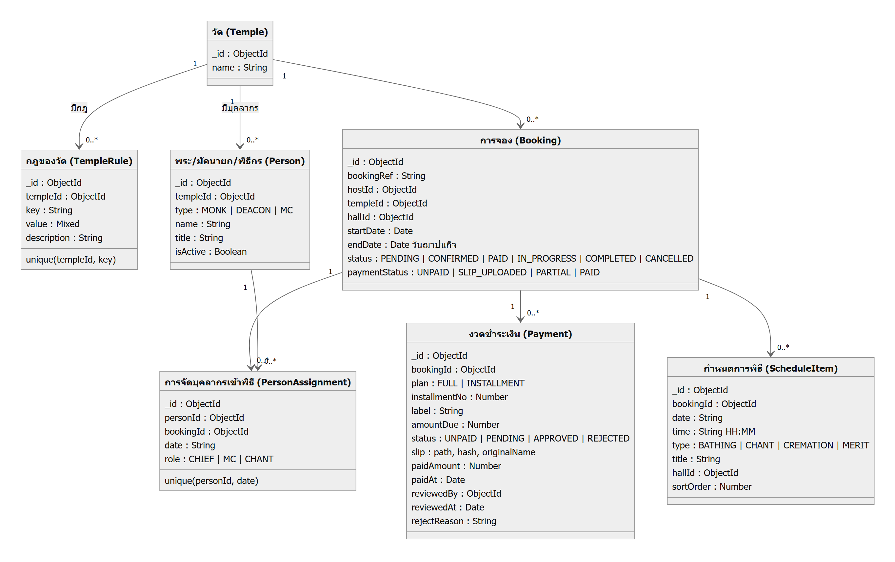

### 3) ดำเนินพิธีหน้างานและระบบสนับสนุน
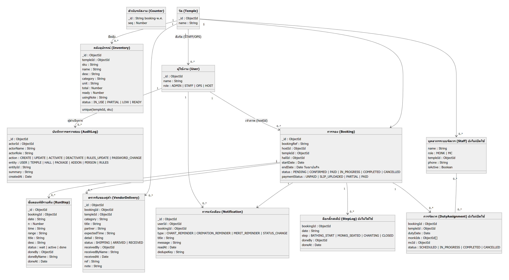

> กล่องที่ติดป้าย "ยังไม่ได้ใช้ / ยังไม่เปิดใช้" มี model ในโค้ดแต่ยังไม่มีหน้าจอเรียกใช้ (StepLog, Staff, DutyAssignment)
> เส้นความสัมพันธ์เป็นการอ้างอิงด้วย ObjectId (MongoDB ไม่มี foreign key จริง)

---

# State Chart (แผนภาพสถานะ) ของระบบ — แนวตั้ง พอดีหน้ากระดาษ Word

เขียนจากเงื่อนไขการเปลี่ยนสถานะจริงใน controller (ต้นฉบับ Mermaid ไฟล์ `state-*.mmd`)

### 1) สถานะงานจอง (Booking.status)
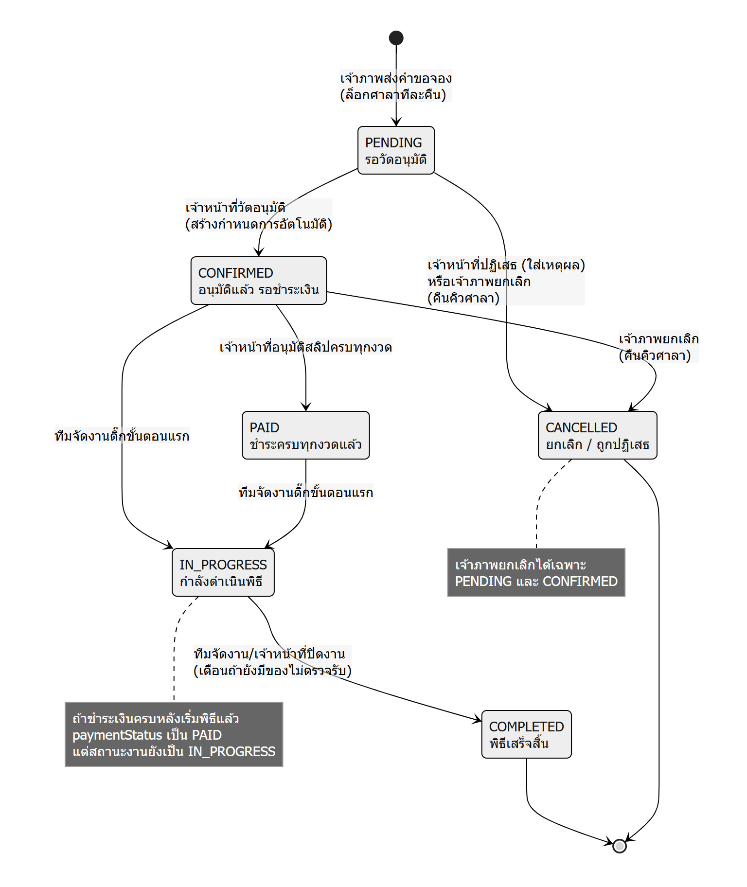

### 2) งวดชำระเงิน (Payment.status)
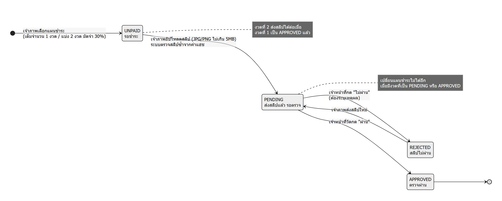

### 3) สถานะการชำระของงาน (Booking.paymentStatus)
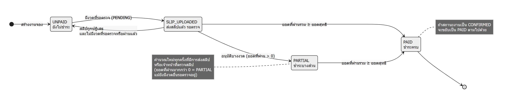

### 4) งานหน้างาน
**4ก) ขั้นตอนพิธีรายคืน (RunStep)**
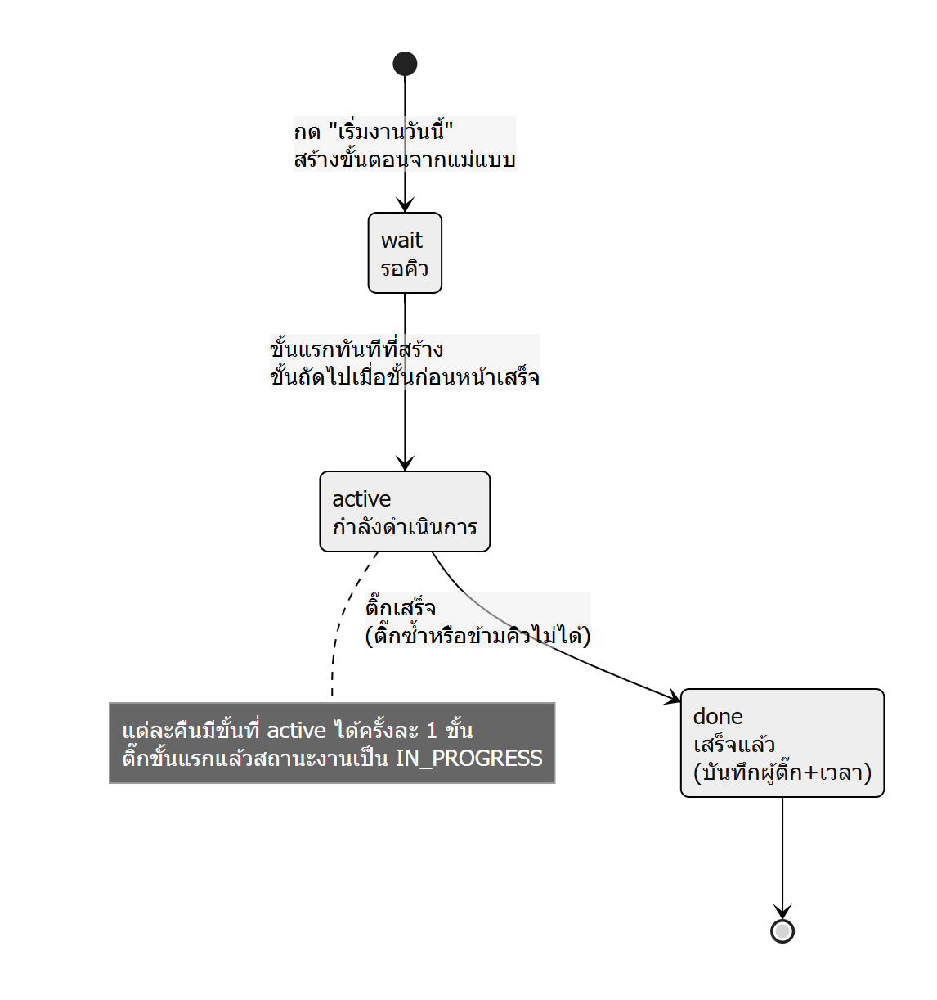

**4ข) การตรวจรับของคู่ค้า (VendorDelivery)**
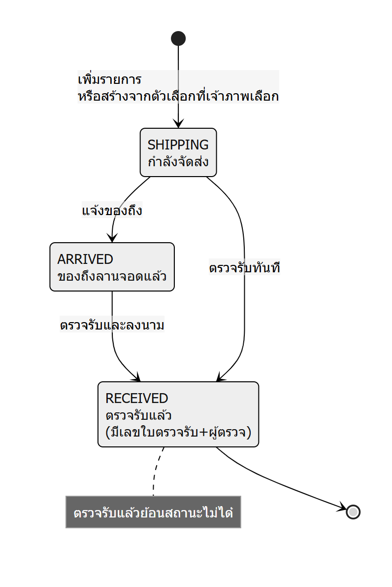

### 5) เปิด-ปิดข้อมูลโดยแอดมิน และลิงก์บัตรเชิญ
**5ก) บัญชีผู้ใช้**
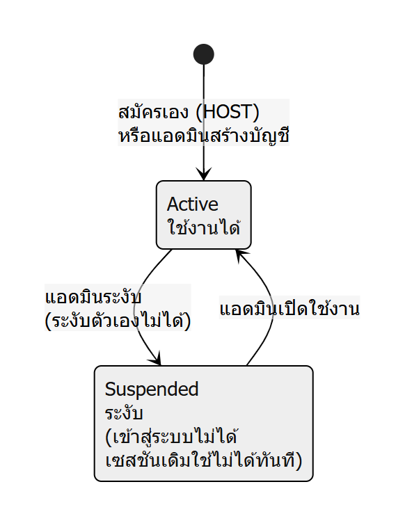

**5ข) ศาลา/เมรุ**
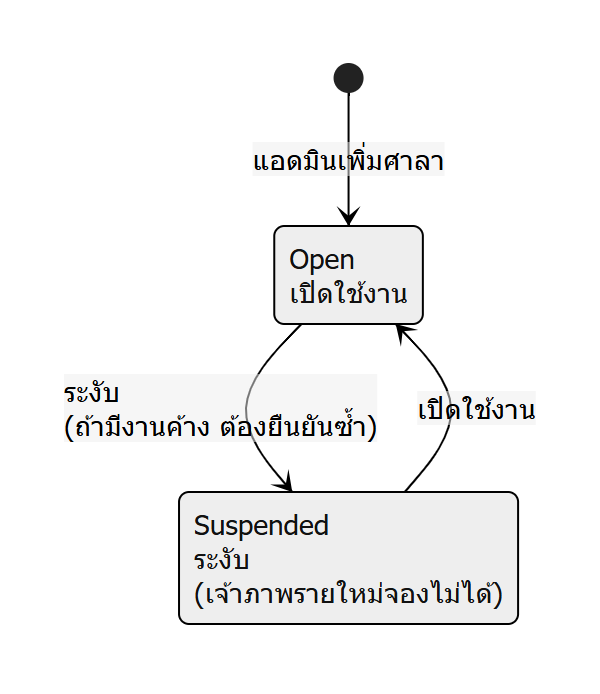

**5ค) แพ็กเกจ / ตัวเลือกเสริม / รายชื่อพระ**
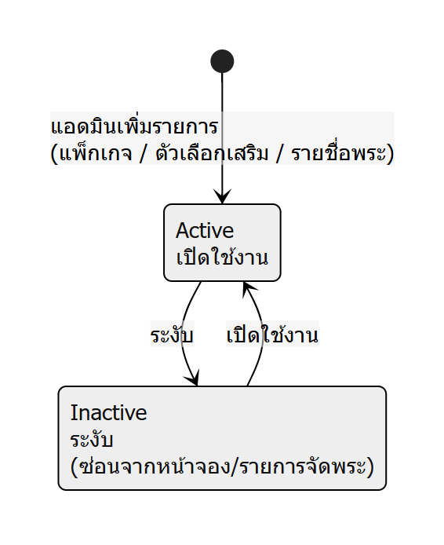

**5ง) ลิงก์บัตรเชิญ**
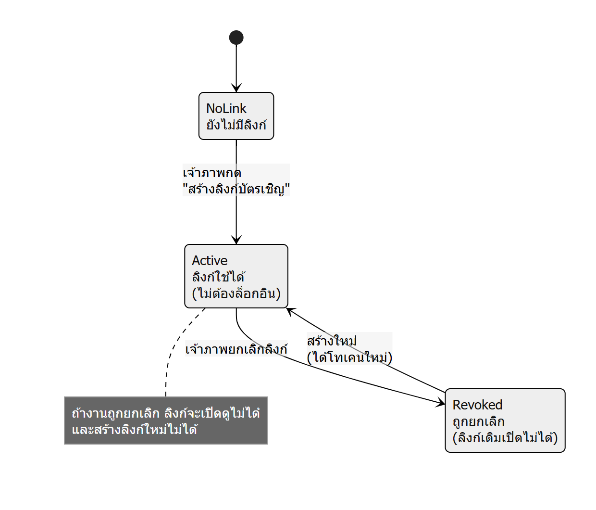
