# แผนภาพคลาสของฐานข้อมูล FOMS (ตรงกับโค้ดบน branch `demo/full-system`)

รูปภาพ: [er-diagram.png](er-diagram.png) · เวกเตอร์ซูมได้: [er-diagram.svg](er-diagram.svg) · ต้นฉบับ Mermaid: [er-diagram.mmd](er-diagram.mmd)

กลุ่มข้อมูล: โครงสร้างวัด/ผู้ใช้ → การจอง → ชำระเงิน/กำหนดการ → ดำเนินพิธีหน้างาน → ระบบ (audit, แจ้งเตือน, ตัวนับ)
ส่วนที่ติดป้าย "ยังไม่ได้ใช้/ยังไม่เปิดใช้" มี model อยู่แต่ยังไม่มีหน้าจอเรียกใช้ (StepLog ของธัชพล, Staff/DutyAssignment ของจิราพัน)

```mermaid
classDiagram
direction TB

class Temple["วัด (Temple)"] {
  _id : ObjectId
  name : String
  address : String
  province : String
  bankName : String
  bankAccount : String
  isActive : Boolean
}
class Hall["ศาลา/เมรุ (Hall, Embedded)"] {
  _id : ObjectId
  name : String
  capacity : Number
  pricePerNight : Number
  kind : HALL | CREMATORIUM
  isActive : Boolean
  code : String
  description : String
  equipment : String
  feeNote : String
}
class User["ผู้ใช้งาน (User)"] {
  _id : ObjectId
  name : String
  phone : String unique
  email : String unique
  password : String hash
  role : ADMIN | STAFF | OPS | HOST
  templeId : ObjectId
  pdpaConsent : Boolean
  isActive : Boolean
  lastLoginAt : Date
  createdAt / updatedAt : Date
}
class Package["แพ็กเกจ (Package)"] {
  _id : ObjectId
  name : String
  level : Economy | Standard | Premium
  basePrice : Number
  snackPerHead : Number
  desc : String
  features : String[]
  recommended : Boolean
  sortOrder : Number
  isActive : Boolean
}
class Addon["ตัวเลือกเสริม (Addon)"] {
  _id : ObjectId
  name : String
  price : Number
  categoryKey : String
  categoryName : String
  packageIds : ObjectId[]
  isDefault : Boolean
  sortOrder : Number
  isActive : Boolean
}
class Booking["การจอง (Booking)"] {
  _id : ObjectId
  bookingRef : String
  hostId : ObjectId
  hostName : String
  deceasedName : String
  templeId : ObjectId
  templeName : String
  hallId : ObjectId
  hallName : String
  hallPricePerNight : Number
  startDate : Date
  endDate : Date วันฌาปนกิจ
  nights : 1 | 3 | 5 | 7
  guests : Number
  packageId : ObjectId
  packageName : String
  packageBasePrice : Number
  snackPerHead : Number
  status : PENDING | CONFIRMED | PAID | IN_PROGRESS | COMPLETED | CANCELLED
  paymentStatus : UNPAID | SLIP_UPLOADED | PARTIAL | PAID
  paymentSlipUrl : String เดิม
  shareToken : String ลิงก์บัตรเชิญ
  rejectReason : String
  cancelReason : String
  createdAt / updatedAt : Date
}
class Pricing["ราคา (pricing, Embedded)"] {
  hallTotal : Number
  snackTotal : Number
  addonsTotal : Number
  grandTotal : Number
}
class BookingAddon["ที่เลือก (addons[], Embedded)"] {
  addonId : ObjectId
  name : String
  price : Number
  categoryKey : String
}
class HallReservation["การล็อกศาลารายคืน (HallReservation)"] {
  _id : ObjectId
  hallId : ObjectId
  bookingId : ObjectId
  date : String YYYY-MM-DD
  unique(hallId, date)
}

class Payment["งวดชำระเงิน (Payment)"] {
  _id : ObjectId
  bookingId : ObjectId
  plan : FULL | INSTALLMENT
  installmentNo : Number
  label : String
  amountDue : Number
  status : UNPAID | PENDING | APPROVED | REJECTED
  slip : path, hash, originalName
  paidAmount : Number
  paidAt : Date
  reviewedBy : ObjectId
  reviewedAt : Date
  rejectReason : String
}
class ScheduleItem["กำหนดการพิธี (ScheduleItem)"] {
  _id : ObjectId
  bookingId : ObjectId
  date : String
  time : String HH:MM
  type : BATHING | CHANT | CREMATION | MERIT
  title : String
  hallId : ObjectId
  sortOrder : Number
}
class TempleRule["กฎของวัด (TempleRule)"] {
  _id : ObjectId
  templeId : ObjectId
  key : String
  value : Mixed
  description : String
  unique(templeId, key)
}
class Person["พระ/มัคนายก/พิธีกร (Person)"] {
  _id : ObjectId
  templeId : ObjectId
  type : MONK | DEACON | MC
  name : String
  title : String
  isActive : Boolean
}
class PersonAssignment["การจัดบุคลากรเข้าพิธี (PersonAssignment)"] {
  _id : ObjectId
  personId : ObjectId
  bookingId : ObjectId
  date : String
  role : CHIEF | MC | CHANT
  unique(personId, date)
}

class RunStep["ขั้นตอนพิธีรายคืน (RunStep)"] {
  _id : ObjectId
  bookingId : ObjectId
  date : String
  n : Number
  time : String
  range : String
  title : String
  desc : String
  status : wait | active | done
  doneBy : ObjectId
  doneByName : String
  doneAt : Date
}
class VendorDelivery["ตรวจรับของคู่ค้า (VendorDelivery)"] {
  _id : ObjectId
  bookingId : ObjectId
  templeId : ObjectId
  category : String
  title : String
  partner : String
  expectedTime : String
  detail : String
  status : SHIPPING | ARRIVED | RECEIVED
  receivedBy : ObjectId
  receivedByName : String
  receivedAt : Date
  ref : String
  note : String
}
class Inventory["คลังอุปกรณ์ (Inventory)"] {
  _id : ObjectId
  templeId : ObjectId
  sku : String
  name : String
  desc : String
  category : String
  unit : String
  total : Number
  ready : Number
  usingNote : String
  status : IN_USE | PARTIAL | LOW | READY
  unique(templeId, sku)
}
class AuditLog["บันทึกการตรวจสอบ (AuditLog)"] {
  _id : ObjectId
  actorId : ObjectId
  actorName : String
  actorRole : String
  action : CREATE | UPDATE | ACTIVATE | DEACTIVATE | RULES_UPDATE | PASSWORD_CHANGE
  entity : USER | TEMPLE | HALL | PACKAGE | ADDON | PERSON | RULES
  entityId : String
  summary : String
  createdAt : Date
}
class Notification["การแจ้งเตือน (Notification)"] {
  _id : ObjectId
  userId : ObjectId
  bookingId : ObjectId
  type : CHANT_REMINDER | CREMATION_REMINDER | MERIT_REMINDER | STATUS_CHANGE
  title : String
  message : String
  readAt : Date
  dedupeKey : String
}
class Counter["ตัวนับรหัสงาน (Counter)"] {
  _id : String booking-พ.ศ.
  seq : Number
}
class StepLog["ล็อกติ๊กสเต็ป (StepLog) ยังไม่ได้ใช้"] {
  bookingId : ObjectId
  date : String
  step : BATHING_START | MONKS_SEATED | CHANTING | CLOSED
  doneBy : ObjectId
  doneAt : Date
}
class Staff["บุคลากรระบบจัดเวร (Staff) ยังไม่เปิดใช้"] {
  name : String
  role : MONK | MC
  templeId : ObjectId
  phone : String
  isActive : Boolean
}
class DutyAssignment["การจัดเวร (DutyAssignment) ยังไม่เปิดใช้"] {
  bookingId : ObjectId
  templeId : ObjectId
  dutyDate : Date
  monkIds : ObjectId[]
  mcId : ObjectId
  status : SCHEDULED | IN_PROGRESS | COMPLETED | CANCELLED
}

%% โครงสร้างวัด / ผู้ใช้
Temple "1" *-- "1..*" Hall : ประกอบด้วย
Temple "1" --> "0..*" User : สังกัด (STAFF/OPS)
Temple "1" --> "0..*" Person : มีบุคลากร
Temple "1" --> "0..*" Inventory : มีคลัง
Temple "1" --> "0..*" TempleRule : มีกฎ

%% การจอง
User "1" --> "0..*" Booking : เจ้าภาพ (hostId)
Temple "1" --> "0..*" Booking
Hall "1" --> "0..*" Booking
Package "1" --> "0..*" Booking
Package "0..*" -- "0..*" Addon : ใช้ได้กับ (packageIds)
Booking *-- "1" Pricing
Booking *-- "0..*" BookingAddon
Addon "1" --> "0..*" BookingAddon : อ้างอิง
Hall "1" --> "0..*" HallReservation
Booking "1" --> "1..*" HallReservation : ล็อกทีละคืน

%% หลังอนุมัติ: ชำระเงิน กำหนดการ ดำเนินพิธี
Booking "1" --> "0..*" Payment
Booking "1" --> "0..*" ScheduleItem
Booking "1" --> "0..*" PersonAssignment
Person "1" --> "0..*" PersonAssignment
Booking "1" --> "0..*" RunStep
Booking "1" --> "0..*" VendorDelivery
Temple "1" --> "0..*" VendorDelivery

%% ระบบ
User "1" --> "0..*" AuditLog : ผู้ดำเนินการ
User "1" --> "0..*" Notification
Booking "1" --> "0..*" Notification
Booking "1" --> "0..*" StepLog
Temple "1" --> "0..*" Staff
Booking "1" --> "0..*" DutyAssignment
Staff "0..*" -- "0..*" DutyAssignment
```

